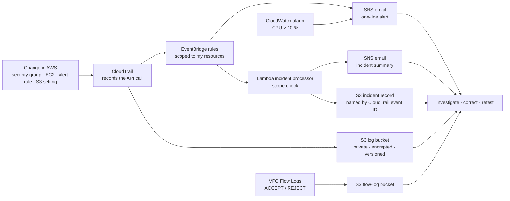

# AWS Cloud Security Monitoring and Incident Response Lab

**CIS 260: Computer Information Systems Field Project** · Jeremiah Banks · Wilbur Wright College, City Colleges of Chicago · Fall 2026

A small AWS lab I built from scratch to practice the full incident-response loop:
**detect** a change, **investigate** it, **preserve** evidence, **correct** the problem, and **retest** to prove the correction worked.

The lab runs in an AWS Academy Learner Lab account ($50 total credit, restricted IAM permissions). Most of the system is AWS configuration, with every setting explained. The one piece of code is a small Python Lambda function ([lambda/](lambda/)) with 23 offline tests and a line-by-line explanation, deployed and tested end to end.

**Result: all 7 controlled tests passed** (Tests 1–2 on Oct 2, Tests 3–7 on Oct 22), and every alert can be matched to its CloudTrail event ID.

---

## Current status — November 13, 2026

| Component | Status | Evidence |
|---|---|---|
| VPC `cis260-security-VPC` (10.26.0.0/16), subnet `cis260-lab-subnet` (10.26.1.0/24), internet gateway, custom route table | ✅ Done | screenshots 01–03, [configuration](docs/configuration.md) |
| Security group `cis260-target-sg`: no inbound rules, outbound HTTPS only | ✅ Done | screenshots 04–05 |
| EC2 target `cis260-target` (t3.micro, Amazon Linux 2023, IMDSv2 required), Session Manager access (no SSH) | ✅ Verified | screenshots 06–07 |
| CloudTrail trail `cis260-management-trail` → private, encrypted, versioned S3 bucket | ✅ Delivery verified | screenshots 08–12, [log sample](evidence/logs/2026-10-02_cloudtrail-sample-redacted.json) |
| SNS topic `cis260-security-alerts`, confirmed email | ✅ Verified | screenshots 13–14 |
| EventBridge alerts: security-group changes and EC2 stop/start, as readable one-line emails | ✅ **Verified end to end** | screenshots 15–16, 23, 30–39 |
| **TEST-01** security-group change · **TEST-02** EC2 stop and restart | ✅ **Both PASS** (2026-10-02) | [IR-01](incidents/IR-01-security-group-change.md), [IR-02](incidents/IR-02-ec2-stop-start.md) |
| VPC Flow Log `cis260-subnet-flowlog` → S3 (attached to `cis260-lab-subnet`) | ✅ Delivering every 5 minutes; REJECT/ACCEPT records used in TEST-03 | screenshots 17, 2026-10-22_40, _48, _57 |
| CloudWatch alarm `cis260-cpu-high` (CPU > 10 %) → SNS | ✅ Fired for real in TEST-04 (ALARM 23:58:15 → OK 00:05:15 UTC) | screenshots 21, 2026-10-22_45–_60 |
| Lambda `cis260-incident-processor` (incident records + readable alerts) + private bucket `cis260-incident-records-jbanks` | ✅ **Deployed 2026-10-22**: 23/23 offline tests, 2/2 synthetic, every real event recorded with its CloudTrail event ID, 0 errors | [lambda/](lambda/), [test output](evidence/logs/2026-10-22_lambda-offline-tests.txt), 2026-10-22_61–_64, _70 |
| Least-privilege IAM policies (what LabRole should be split into) | ✅ Written (reference; Learner Lab blocks creating roles) | [config/iam/](config/iam/), [least-privilege.md](docs/least-privilege.md) |
| **TEST-03** blocked vs. allowed traffic · **TEST-04** CPU alarm · **TEST-05** S3 control · **TEST-06** Lambda end to end · **TEST-07** alert-rule tampering (the security improvement) | ✅ **All PASS** (2026-10-22) | [test plan](docs/test-plan.md), [IR-03](incidents/IR-03-blocked-vs-allowed-traffic.md), [IR-04](incidents/IR-04-cpu-alarm.md), [IR-05](incidents/IR-05-alert-rule-disabled.md), [control improvement](docs/control-improvement.md) |
| Demo recording | 📅 To record | — |

## How it works



| Source | Answers | Example |
|---|---|---|
| CloudTrail | **Who changed what, when, from where** (API calls) | `AuthorizeSecurityGroupIngress` by my lab session at 22:31:23 UTC |
| VPC Flow Logs | **Which traffic was allowed or blocked** (network metadata, no packet contents) | client → target port 8080 `REJECT` |
| CloudWatch | **How the server is performing** (metrics) | CPUUtilization above 10 % → ALARM |

Diagram as an image: [docs/images/architecture.png](docs/images/architecture.png)

EventBridge receives CloudTrail events directly from AWS; it does not read the log files in S3. S3 is the long-term evidence; the email is the fast notification. The Lambda function never changes anything. A person reviews the evidence and makes the fix ([why](docs/decisions.md#d-12--lambda-records-evidence-it-does-not-fix-things-automatically)).

## Architecture at a glance

| Layer | Resource | Key settings |
|---|---|---|
| Network | `cis260-security-VPC`, `cis260-lab-subnet` | 10.26.0.0/16 and 10.26.1.0/24, us-east-1 |
| | `cis260-Lab-igw`, `cis260-lab-rt` | 0.0.0.0/0 → internet gateway; no NAT gateway (cost) |
| Firewall | `cis260-target-sg` | inbound: none · outbound: HTTPS (TCP 443) only |
| Compute | `cis260-target` | t3.micro, Amazon Linux 2023, role LabRole, IMDSv2 required |
| Access | Session Manager | shell as `ssm-user`, no SSH keys, no inbound port |
| Logging | `cis260-management-trail` | management events, multi-region, delivers to S3 |
| Evidence | `cis260-security-logs-jbanks-20261002` | Block all public access, SSE-S3, versioning, bucket policy limited to my trail |
| Network logging | `cis260-subnet-flowlog` | all traffic, 1-minute aggregation → `cis260-flowlogs-jbanks-20261002` |
| Metrics | `cis260-cpu-high` | CPUUtilization > 10 % for one 5-minute period → SNS |
| Alerting | `cis260-security-alerts` + rules `cis260-sg-changes`, `cis260-ec2-api-changes` | readable one-line emails (input transformer) |
| Incident records | `cis260-incident-processor` → `cis260-incident-records-jbanks` | Python 3.12 Lambda (LabRole), outside the VPC; 4 Lambda-target rules incl. `cis260-monitoring-integrity` |

Every setting and the reason for it: [docs/configuration.md](docs/configuration.md).

## The code and how to test it

| Path | What it is |
|---|---|
| [lambda/lambda_function.py](lambda/lambda_function.py) | The incident processor: scope check → full event saved to S3 → readable email (76 lines) |
| [lambda/test_lambda_function.py](lambda/test_lambda_function.py), [lambda/test_event_patterns.py](lambda/test_event_patterns.py) | 23 offline tests (fake S3/SNS, no AWS account needed) |
| [lambda/events/](lambda/events/) | Synthetic test events |
| [config/](config/README.md) | EventBridge patterns and IAM policies, explained line by line |

```
python -m unittest discover -s lambda -v
```

Expected: `Ran 23 tests ... OK` ([saved output from 2026-10-22](evidence/logs/2026-10-22_lambda-offline-tests.txt)). Deploy steps: [lambda/README.md](lambda/README.md). Every line explained: [docs/lambda-line-by-line.md](docs/lambda-line-by-line.md).

## Quickstart

1. **Read the results first:** [docs/test-plan.md](docs/test-plan.md) (all seven tests with times and evidence), then one incident record, for example [IR-05](incidents/IR-05-alert-rule-disabled.md).
2. **Run the code's tests on your own computer** (no AWS account needed):
   ```
   git clone https://github.com/Jbee1984/cis260-aws-cloud-security-lab.git
   cd cis260-aws-cloud-security-lab
   python -m unittest discover -s lambda -v
   ```
3. **Rebuild the lab in your own AWS account:** follow [docs/configuration.md](docs/configuration.md) section by section (every setting and the reason for it), then deploy the function with [lambda/README.md](lambda/README.md). The event patterns are in [config/](config/README.md).
4. **Check the evidence:** every screenshot is listed with its SHA-256 hash in [evidence/manifest.md](evidence/manifest.md).

## Setting up a workspace

| Need | What to use |
|---|---|
| Run the offline tests | Python 3.10 or newer (written and run on 3.12). Nothing to install: the tests replace `boto3` with fakes. On Windows, `py -m unittest discover -s lambda -v` |
| Deploy the function | An AWS account in **us-east-1**. In AWS Academy Learner Lab, use **LabRole** as the execution role; in a normal account, create the three roles in [docs/least-privilege.md](docs/least-privilege.md) instead |
| Run the tests in AWS | **AWS CloudShell** (AWS CLI in the browser, no keys on your PC) and **Session Manager** for the server. The exact commands used are in [lambda/README.md](lambda/README.md#what-was-actually-run-2026-10-22) |
| Budget | About $0.37/day while the server runs; stop it when you finish. Costs are tracked in [docs/cost-log.md](docs/cost-log.md) |
| End of a session | [docs/cleanup-checklist.md](docs/cleanup-checklist.md) |

## Troubleshooting

| Symptom | Where to look |
|---|---|
| No alert email arrives | [config/README.md → "If an email does not arrive"](config/README.md#if-an-email-does-not-arrive): wait, check the Region, rule monitoring, LabRole's `sns:Publish`, topic encryption, pattern typos |
| CloudTrail console shows `AccessDeniedException` | The trail can still work. Check for a delivered log file, not the banner: [ISSUE-01](docs/issues.md#issue-01--cloudtrail-console-accessdeniedexception) |
| The server stopped by itself | The 4-hour Learner Lab session ended. Start a new session; the automatic stop is a `StopInstances` call by the lab's `sys…` identity: [ISSUE-02](docs/issues.md#issue-02--learner-lab-session-expired-during-the-build) |
| Alert emails are raw JSON | Use an input transformer on the rule target: [ISSUE-03](docs/issues.md#issue-03--alert-emails-were-raw-json-and-hard-to-read---fixed-and-verified) |
| A blocked connection shows `ACCEPT` in Flow Logs | You are reading the sender's interface. Filter on the target's interface ID: [IR-03](incidents/IR-03-blocked-vs-allowed-traffic.md#analysis-note-why-the-blocked-attempt-also-shows-an-accept) |
| Flow-log or CloudTrail evidence is missing right after a test | Both arrive minutes later (flow-log files about every 5 minutes; Event history lags). EventBridge and the function react in seconds |
| The function returns `"ignored"` | The scope check rejected the event: wrong account, Region, API call, or resource. The `reason` field says which: [docs/lambda-line-by-line.md](docs/lambda-line-by-line.md#step-1-scope-check-lines-4352) |
| Two emails for one change | Expected while both the SNS rule and the Lambda rule are enabled ([D-16](docs/decisions.md#d-16--separate-lambda-rules-the-original-alert-rules-stay)) |
| An evidence file's hash doesn't match the manifest | Git may have converted its line endings. This repository's `.gitattributes` prevents that for `evidence/`: [ISSUE-04](docs/issues.md#issue-04--a-published-evidence-file-didnt-match-its-manifest-hash---fixed-and-verified) |

## FAQ

- **Why a Lambda function when EventBridge can already email?** The email is a notification. The function adds a permanent case record named by the CloudTrail event ID, a second scope check, and FAILED-versus-succeeded reporting ([D-12](docs/decisions.md#d-12--lambda-records-evidence-it-does-not-fix-things-automatically)).
- **Why doesn't it fix the problem automatically?** An automatic fix can't tell an approved change from a malicious one and could break a legitimate change. A person reviews the evidence, corrects, and retests.
- **What would you change about LabRole?** Split it into three least-privilege roles. The policies are written in [config/iam/](config/iam/) and explained in [docs/least-privilege.md](docs/least-privilege.md).
- **Why Session Manager instead of SSH?** No inbound port, no keys, and every session is in CloudTrail ([D-01](docs/decisions.md#d-01--session-manager-instead-of-ssh)).
- **Why no NAT gateway?** About $1.08/day versus $0.12/day for a public IPv4 address, and inbound stays closed either way ([D-04](docs/decisions.md#d-04--internet-gateway-and-public-ip-instead-of-a-nat-gateway)).
- **What does it cost?** The Learner Lab showed $2.40 of the $50 credit used after the final test session on October 22, and that figure includes earlier work in the same lab account. A stopped server still pays for its disk, about $0.04 a day ([docs/cost-log.md](docs/cost-log.md)).
- **What does it not detect?** Malware, denial of service, or real customer data were never in scope. The integrity rule watches one alert rule; `DeleteRule`, `RemoveTargets`, and CloudTrail `StopLogging` are next steps ([docs/control-improvement.md](docs/control-improvement.md#what-it-does-not-cover-residual-risk)).
- **Are the screenshots edited?** No. They are the unredacted originals, each with its SHA-256 hash in [evidence/manifest.md](evidence/manifest.md).

## Repository map

| Path | What it holds |
|---|---|
| [docs/work-log.md](docs/work-log.md) | Dated record of every work session |
| [docs/configuration.md](docs/configuration.md) | Every resource, every setting, and why |
| [docs/decisions.md](docs/decisions.md) | Design decisions and the alternatives I rejected |
| [docs/issues.md](docs/issues.md) | Problems: expected vs. actual, diagnosis, fix, retest |
| [docs/test-plan.md](docs/test-plan.md) | All seven tests: steps, expected results, actual results |
| [docs/control-improvement.md](docs/control-improvement.md) | The before/after security improvement |
| [docs/least-privilege.md](docs/least-privilege.md) | LabRole, why it's too broad, and the roles I'd use instead |
| [docs/lambda-line-by-line.md](docs/lambda-line-by-line.md) | The function explained line by line |
| [docs/cost-log.md](docs/cost-log.md) | Credit tracking against the $30 internal ceiling |
| [docs/cleanup-checklist.md](docs/cleanup-checklist.md) | End-of-session and end-of-project shutdown steps |
| [lambda/](lambda/README.md) | The code, its tests, and deploy steps |
| [config/](config/README.md) | Event patterns and IAM policies |
| [incidents/](incidents/) | Incident records for each controlled test (and a template) |
| [evidence/](evidence/manifest.md) | Original (unredacted) screenshots, log samples, test output, and the evidence manifest with SHA-256 hashes |

## What is deliberately *not* in this repository

- No secret keys, passwords, or session tokens. The screenshots are published unredacted, so they show the Learner Lab account ID, my source IP address, my lab user name and school email address, and the IDs of temporary access keys (the short-lived key IDs only, never a secret key) (see [evidence/manifest.md](evidence/manifest.md)).
- No raw CloudTrail logs. Originals stay offline; only redacted samples are published.
- No credentials of any kind. The Lambda function gets its permissions from its execution role, never from keys in code.

## Timeline

| Dates | Work | Status |
|---|---|---|
| Aug 28 – Sep 4 | Topic, proposal, AWS access | ✅ |
| Late Sep – Oct 2 | Foundation, logging, alerting, TEST-01 and TEST-02 | ✅ |
| Oct 9 | Midterm presentation | ✅ |
| Oct 22 | Lambda incident processor, 23 offline tests, least-privilege policies, final test procedures | ✅ |
| Oct 22 (evening) | TEST-03 to TEST-07 run and passed; Lambda deployed; incident records IR-03 to IR-05 | ✅ |
| Nov 12 – 13 | README pass (quickstart, workspace setup, troubleshooting, FAQ); post-session evidence published | ✅ |
| Before Dec 4 | Demo recording; final paper; final slides | 📅 |
| Dec 4 | Final paper, repository, and slides due before class | 📅 |
| Dec 4 and Dec 11 | Final presentations | 📅 |

## Scope and boundaries

All testing stays inside my Learner Lab account and uses synthetic data only. No denial-of-service, malware, phishing, scanning of systems I don't own, or attacks against AWS infrastructure.