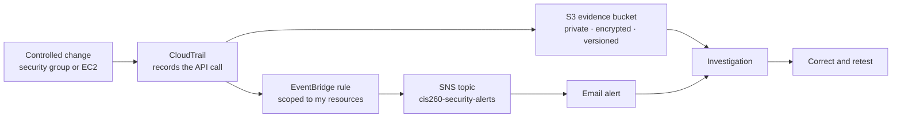

# AWS Cloud Security Monitoring and Incident Response Lab

**CIS 260: Computer Information Systems Field Project** · Jeremiah Banks · Wilbur Wright College, City Colleges of Chicago · Fall 2026

A small AWS lab I am building from scratch to practice the full incident-response loop:
**detect** a change, **investigate** it, **preserve** evidence, **correct** the problem, and **retest** to prove the correction worked.

The lab runs in an AWS Academy Learner Lab account ($50 total credit, restricted IAM permissions). Everything here is configured through AWS service settings and short, explained event patterns — no large templates or scripts I can't explain line by line.

---

## Current status — midterm (October 2, 2026)

| Component | Status | Evidence |
|---|---|---|
| VPC `cis260-security-VPC` (10.26.0.0/16) and subnet `cis260-lab-subnet` (10.26.1.0/24) | ✅ Done | [work log](docs/work-log.md) |
| Internet gateway, custom route table, subnet association | ✅ Done 2026-10-02 | screenshots 01–03 |
| Security group `cis260-target-sg` — no inbound rules, outbound HTTPS only | ✅ Done 2026-10-02 | screenshots 04–05 |
| EC2 target `cis260-target` (t3.micro, Amazon Linux 2023, IMDSv2 required) | ✅ Done 2026-10-02 | screenshot 06 |
| Systems Manager Session Manager access (no SSH) | ✅ Verified 2026-10-02 | screenshot 07 |
| CloudTrail trail `cis260-management-trail` → S3 | ✅ Verified delivery 2026-10-02 | screenshots 08–09, [log sample](evidence/logs/2026-10-02_cloudtrail-sample-redacted.json) |
| S3 evidence bucket protections (Block Public Access, SSE-S3, versioning) | ✅ Verified 2026-10-02 | screenshots 10–12 |
| SNS topic `cis260-security-alerts` with confirmed email subscription | ✅ Manual test SNS-01 delivered | screenshots 13–14 |
| EventBridge rule `cis260-ec2-api-changes` (EC2 stop/start via CloudTrail) | ✅ **Verified** — alert emails for StopInstances (4:52 PM) and StartInstances (4:54 PM) | screenshots 15–16, 30–31 |
| EventBridge rule `cis260-sg-changes` (security-group inbound changes via CloudTrail) | ✅ **Verified** — alert emails for Authorize (5:31 PM) and Revoke (5:41 PM) | screenshots 23, 32–33 |
| Test 1 — security-group change / Test 2 — EC2 stop and restart | ✅ **Both PASS** (2026-10-02) | [IR-01](incidents/IR-01-security-group-change.md), [IR-02](incidents/IR-02-ec2-stop-start.md) |
| VPC Flow Log `cis260-subnet-flowlog` → S3 | ✅ Active since 2026-10-02 4:47 PM — first-delivery check pending | screenshot 17 |
| CloudWatch alarm `cis260-cpu-high` (CPU > 10%) | ✅ Created 2026-10-02 5:11 PM; state OK at 5:12 PM (receiving data) — not yet triggered (Test 4) | screenshot 21 |
| Tests 3–4, security improvement and retest | 📅 Planned Oct 17 – Nov 13 | [test plan](docs/test-plan.md) |

## How logging and alerting work

EventBridge receives events directly from AWS — it does not read the log files in S3. S3 is the long-term evidence; the email is the fast notification.

## Architecture at a glance

| Layer | Resource | Key settings |
|---|---|---|
| Network | `cis260-security-VPC` | 10.26.0.0/16, us-east-1 |
| | `cis260-lab-subnet` | 10.26.1.0/24, auto-assigned public IPv4 |
| | `cis260-Lab-igw` | attached to the VPC |
| | `cis260-lab-rt` | 0.0.0.0/0 → internet gateway, 10.26.0.0/16 → local; explicitly associated with the subnet |
| Firewall | `cis260-target-sg` | inbound: none · outbound: HTTPS (TCP 443) to 0.0.0.0/0 only |
| Compute | `cis260-target` | t3.micro, Amazon Linux 2023, role LabRole, IMDSv2 required |
| Access | Session Manager | shell as `ssm-user`, no SSH keys, no inbound port |
| Logging | `cis260-management-trail` | management events, multi-region, delivers to S3 |
| Evidence | `cis260-security-logs-jbanks-20261002` | Block all public access on, SSE-S3, versioning on, bucket policy limited to my trail |
| Network logging | `cis260-subnet-flowlog` | VPC Flow Log, all traffic, 1-minute aggregation, delivered to S3 bucket `cis260-flowlogs-jbanks-20261002` |
| Alerting | `cis260-security-alerts` | standard SNS topic, one confirmed email subscription |
| | `cis260-ec2-api-changes` | EventBridge rule: CloudTrail `StopInstances`/`StartInstances` for `cis260-target` → SNS (role LabRole) |

Full explanations of every setting: [docs/configuration.md](docs/configuration.md).

## Repository map

| Path | What it holds |
|---|---|
| [docs/work-log.md](docs/work-log.md) | Dated record of every work session |
| [docs/configuration.md](docs/configuration.md) | Every resource, every setting, and why |
| [docs/decisions.md](docs/decisions.md) | Design decisions and the reasons behind them |
| [docs/issues.md](docs/issues.md) | Problems: expected vs. actual, diagnosis, fix, retest |
| [docs/test-plan.md](docs/test-plan.md) | The controlled tests and their pass criteria |
| [docs/cost-log.md](docs/cost-log.md) | Credit tracking against the $30 internal ceiling |
| [docs/cleanup-checklist.md](docs/cleanup-checklist.md) | End-of-session and end-of-project shutdown steps |
| [config/](config/README.md) | EventBridge event patterns, explained line by line |
| [incidents/](incidents/) | Incident records for each controlled test |
| [evidence/](evidence/manifest.md) | Original (unredacted) screenshots, a redacted log sample, and the evidence manifest |

## What is deliberately *not* in this repository

- No secret keys or passwords. The screenshots are published unredacted, so they show the Learner Lab account ID, source IP address, and lab user details (see [evidence/manifest.md](evidence/manifest.md)).
- No raw CloudTrail logs. Originals stay offline; only redacted samples are published.
- No credentials of any kind.

## Timeline

| Dates | Work |
|---|---|
| Oct 3–9 | Catch-up: VPC Flow Logs, first CloudWatch CPU alarm, finish IR-01 and IR-02 |
| Oct 10–16 | Strengthen the security-group and EC2 investigations; verify a third alert type |
| Oct 17–30 | Test 3 (rejected vs. allowed traffic in Flow Logs) and Test 4 (CPU metric alarm) |
| Oct 31 – Nov 13 | Security improvement with before/after evidence and retest; second check-in |
| Nov 14–20 | Restart and cleanup procedures; reconcile costs; close documentation gaps |
| Nov 21–27 | Final technical paper draft |
| Nov 28 – Dec 3 | Final validation and presentation preparation |
| Dec 4 | Final paper, repository, and presentation |

## Scope and boundaries

All testing stays inside my Learner Lab account and uses synthetic data only. No denial-of-service, malware, phishing, scanning of systems I don't own, or attacks against AWS infrastructure. AWS access for this project was authorized by Professor Gustavo Allata of Wilbur Wright College.
